  

  
  
  
  
  
  

  <b>15+ years</b> building products and the teams behind them &nbsp;·&nbsp; <b>2 exits</b> &nbsp;·&nbsp; Munich area 🇩🇪

---

## 👋 About me

I lead engineering teams and still like to get my hands on the code. I care
about teams that ship and own what they ship, leadership that adapts to the
person instead of the other way round, and **honest numbers over good stories**.

<table>
  <tr>
    <td width="33%" valign="top">
      <h3>🧭 Lead</h3>
      Most recently <b>Team Lead Digital Products</b> at Interhyp: a
      cross-functional team plus additional squads, about <b>20 engineers</b>
      including nearshore.
    </td>
    <td width="33%" valign="top">
      <h3>🚀 Build</h3>
      Founded <b>mBook</b>, a digital learning platform, acquired by
      <b>Cornelsen Verlag</b>, and <b>RegioPay</b>, a regional payment
      system for the Chiemgau region.
    </td>
    <td width="33%" valign="top">
      <h3>⌨️ Code</h3>
      <b>TypeScript, React, NestJS</b> day to day. Python where it fits.
      Lately: AI agents that act in the real world, safely.
    </td>
  </tr>
</table>

## 🔬 Featured project

<table>
  <tr>
    <td>
      <h3><a href="https://github.com/r1ckyrockz/day-trader-skill">day-trader-skill</a></h3>
      Eleven Claude skills for day trading, from chart scanner to order
      ticket, behind a <b>hard order gate that runs outside the model</b>.
      Then the honest part: a backtest across <b>75 stocks and two years</b>
      with realistic fills and a clean in-sample / out-of-sample split.
        
      <b>Verdict: the strategy loses money after costs.</b> The repo says so
      at the top, so nobody has to find out with real money.
        
      <code>Python</code> <code>Claude Code</code> <code>Backtesting</code> <code>AI Safety</code>
    </td>
  </tr>
</table>

## 🛠️ Currently tinkering with

- 🤖 **Agents with real-world consequences**: hard gates outside the model, untrusted text treated as data, tests that guard against self-deception
- 🏠 **Home automation** with Home Assistant and ESPHome
- 🧠 **Local AI** running at home

## 🤝 Let's connect

  

Engineering leadership, founder stories, or why most trading strategies don't survive their own backtest: happy to talk.
